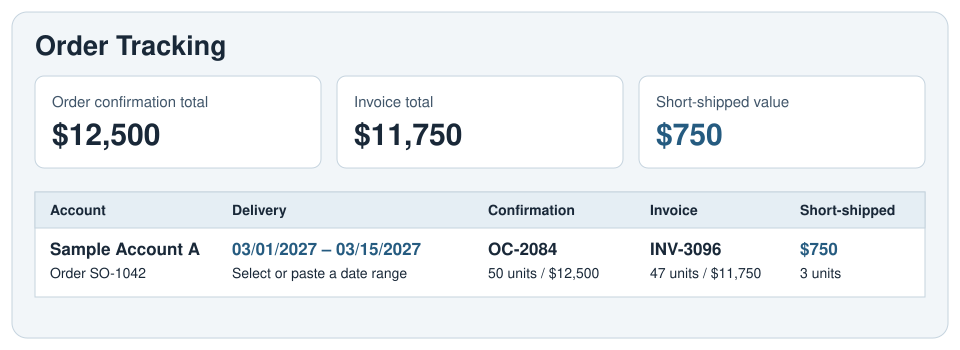

# Order Reconciliation Dashboard

I built a dashboard for comparing confirmed orders with invoices and flagging discrepancies for bookkeeping follow-up. It keeps order and invoice references, delivery dates, commission status, and notes together.

- **Reconcile orders against invoices.** Compare the confirmed amount with the invoiced amount. In the example, $12,500 confirmed minus $11,750 invoiced leaves a $750 difference to review.
- **Use one delivery range field.** Select two dates or paste a date range into a single field.
- **Keep follow-up in context.** Review the shipment difference alongside the original order and invoice references.

This is a sanitized project write-up and visual based on the dashboard I developed. All records and amounts shown here are fictional. Production code, client data, and live connections are not included.
